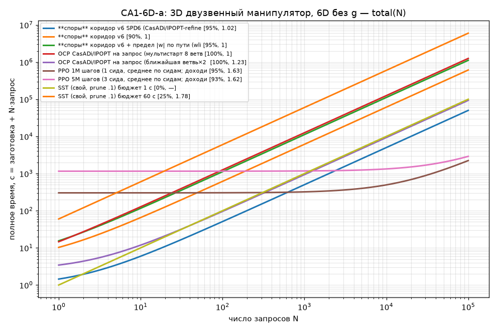

# CA1-6D-a: 3D двузвенный манипулятор, 6D без g
20 стартов (поток rng(0), исключено эталоном 0); эталон T_ref — OCP CasADi/IPOPT (multiple shooting, 8 ветвей 2π × 4 затравки); единый проверяльщик `common.verify` (RK4 h .01) с допусками эталона: окно +1e-3, |w|≤3+1e-2. Цель — покой в q=0 (окно |q|<.3, |w|<.6). aida, CPU (запросы по 1 ядру; машина разделена с другими линиями, загрузка 20–25 из 32 ядер — времена запросов спор/OCP 8D завышены).
Пометка: T/T_ref < 1 возможно из-за допусков эталона и кусочно-постоянного u у эталона (N=50).

| метод | параметры | заготовка, с | запрос мед. / p90, с | total(N=20), с | дошли | T/T_ref мед / ср / p90 / max | вес данных | железо | примечание |
|---|---|---|---|---|---|---|---|---|---|
| **споры** коридор v6 SPD6 (CasADi/IPOPT-refine + скомпилированный поток, |w|≤3 по пути) | NB 12000, NF 1000, K 3, NEIGH 0; 1 ядро, taskset, OMP=1; load average aida при прогоне ~6 | 0.945 | 0.501 / 0.549 | 11 | 95% | 1.02 / 1.08 / 1.18 / 1.38 | 18.7 МБ | CPU numpy+math | ФИНАЛ: IPOPT-refine (запас .004), gcc-поток; без wlim |
| **споры** коридор v6 | NB 12000, NF 3000, K 3; 1 ядро/запрос | 4.17 | 6.13 / 10.1 | 127 | 90% | 1 / 1.01 / 1.02 / 1.05 | 18.7 МБ | CPU numpy+math | SLSQP-доводка держит |w|≤3 только в узлах |
| **споры** коридор v6 + предел |w| по пути (wlim) | NB 12000, NF 3000, K 3; 1 ядро/запрос | 4.27 | 11.2 / 14.9 | 228 | 95% | 1 / 1.01 / 1.03 / 1.13 | 18.7 МБ | CPU numpy+math | жёсткий предел |w|≤3 в 16 точках сегмента |
| OCP CasADi/IPOPT на запрос (мультистарт 8 ветвей×4 затравки = эталон) | multiple shooting N50 M4 | 2.09 | 12.5 / 15.2 | 253 | 100% | 1 / 1 / 1 / 1 | — | CPU 1 проц. | сборка символьной задачи — «заготовка»; multi — тот же алгоритм, что дал T_ref, ⇒ 1.000 по построению |
| OCP CasADi/IPOPT на запрос (ближайшая ветвь×2 затравки) | multiple shooting N50 M4 | 2.51 | 0.934 / 1.51 | 21.2 | 100% | 1.23 / 1.27 / 1.56 / 2 | — | CPU 1 проц. |  |
| PPO 1M шагов (1 сида, среднее по сидам; доходимость сидов 95%) | MlpPolicy 64×64, 16 env, CPU | 303 | 0.0193 / — | 303 | 95% | 1.63 / 1.68 / 2.13 / 2.7 | 39.5 КБ | CPU | до 95% дошёл за 214 с (сид 0); вес = 9863 параметров float32 (+VecNormalize) |
| PPO 5M шагов (3 сида, среднее по сидам; доходимость сидов 100%/95%/85%) | MlpPolicy 64×64, 16 env, CPU | 1.16e+03 | 0.0175 / — | 1.16e+03 | 93% | 1.62 / 1.6 / 2.01 / 2.29 | 39.5 КБ | CPU | до 95% дошёл за 237 с (сид 0); вес = 9863 параметров float32 (+VecNormalize) |
| SST (свой, prune .1) бюджет 0.3 с | sel .2 / prune .1; одиночный запрос | 0 | 0.3 / — | 6 | 0% | — / — / — / — | 179 КБ | CPU numpy | запрос = бюджет (anytime); дерево строится в запросе |
| SST (свой, prune .1) бюджет 1 с | sel .2 / prune .1; одиночный запрос | 0 | 1 / — | 20 | 0% | — / — / — / — | 468 КБ | CPU numpy | запрос = бюджет (anytime); дерево строится в запросе |
| SST (свой, prune .1) бюджет 3 с | sel .2 / prune .1; одиночный запрос | 0 | 3 / — | 60 | 0% | — / — / — / — | 977 КБ | CPU numpy | запрос = бюджет (anytime); дерево строится в запросе |
| SST (свой, prune .1) бюджет 10 с | sel .2 / prune .1; одиночный запрос | 0 | 10 / — | 200 | 15% | 1.96 / 2.08 / 2.41 / 2.52 | 1.99 МБ | CPU numpy | запрос = бюджет (anytime); дерево строится в запросе |
| SST (свой, prune .1) бюджет 60 с | sel .2 / prune .1; одиночный запрос | 0 | 60 / — | 1.2e+03 | 25% | 1.78 / 1.91 / 2.3 / 2.52 | 4.28 МБ | CPU numpy | запрос = бюджет (anytime); дерево строится в запросе |

### Безубыточность N* (total = заготовка + N·запрос), относительно спор (v6)
- **споры** коридор v6: споры дешевле при любом N (N* = 0) — качество ХУЖЕ спор, N* несопоставим: дошли 90% (споры 95%), T/T_ref мед 1 (споры 1.02)
- **споры** коридор v6 + предел |w| по пути (wlim): споры дешевле при любом N (N* = 0) — качество не хуже спор: дошли 95% (споры 95%), T/T_ref мед 1 (споры 1.02)
- OCP CasADi/IPOPT на запрос (мультистарт 8 ветвей×4 затравки = эталон): споры дешевле при любом N (N* = 0) — качество не хуже спор: дошли 100% (споры 95%), T/T_ref мед 1 (споры 1.02)
- OCP CasADi/IPOPT на запрос (ближайшая ветвь×2 затравки): споры дешевле при любом N (N* = 0) — качество ХУЖЕ спор, N* несопоставим: дошли 100% (споры 95%), T/T_ref мед 1.23 (споры 1.02)
- PPO 1M шагов (1 сида, среднее по сидам; доходимость сидов 95%): метод дешевле спор при N > 626 — качество ХУЖЕ спор, N* несопоставим: дошли 95% (споры 95%), T/T_ref мед 1.63 (споры 1.02)
- PPO 5M шагов (3 сида, среднее по сидам; доходимость сидов 100%/95%/85%): метод дешевле спор при N > 2393 — качество ХУЖЕ спор, N* несопоставим: дошли 93% (споры 95%), T/T_ref мед 1.62 (споры 1.02)
- SST (свой, prune .1) бюджет 0.3 с: метод дешевле спор при любом N — качество ХУЖЕ спор, N* несопоставим: дошли 0% (споры 95%), T/T_ref мед — (споры 1.02)
- SST (свой, prune .1) бюджет 1 с: споры дешевле метода при N > 2 — качество ХУЖЕ спор, N* несопоставим: дошли 0% (споры 95%), T/T_ref мед — (споры 1.02)
- SST (свой, prune .1) бюджет 3 с: споры дешевле метода при N > 0 — качество ХУЖЕ спор, N* несопоставим: дошли 0% (споры 95%), T/T_ref мед — (споры 1.02)
- SST (свой, prune .1) бюджет 10 с: споры дешевле метода при N > 0 — качество ХУЖЕ спор, N* несопоставим: дошли 15% (споры 95%), T/T_ref мед 1.96 (споры 1.02)
- SST (свой, prune .1) бюджет 60 с: споры дешевле метода при N > 0 — качество ХУЖЕ спор, N* несопоставим: дошли 25% (споры 95%), T/T_ref мед 1.78 (споры 1.02)

