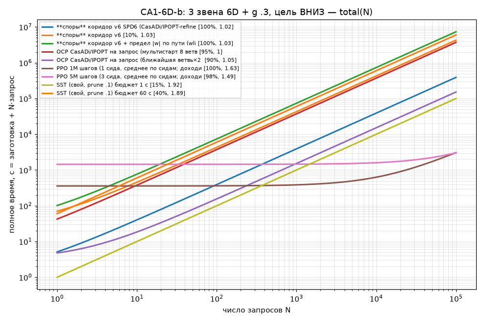
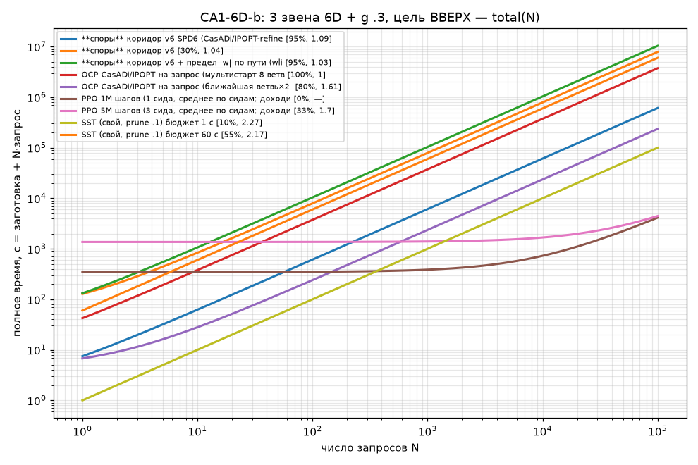

# CA1-6D-b: 3 звена 6D + g .3, цель ВНИЗ
20 стартов (поток rng(0), исключено эталоном 0); эталон T_ref — OCP CasADi/IPOPT (multiple shooting, 8 ветвей 2π × 4 затравки; для 3g — лучшее известное из r5 ref6d_T.json (|w|≤3 по пути)); единый проверяльщик `common.verify` (RK4 h .01) с допусками эталона: окно +1e-3, |w|≤3+1e-2. Цель — покой в q=0 (окно |q|<.3, |w|<.6). aida, CPU (запросы по 1 ядру; машина разделена с другими линиями).
Пометка: T/T_ref < 1 возможно из-за допусков эталона и кусочно-постоянного u у эталона (N=50).

| метод | параметры | заготовка, с | запрос мед. / p90, с | total(N=20), с | дошли | T/T_ref мед / ср / p90 / max | вес данных | железо | примечание |
|---|---|---|---|---|---|---|---|---|---|
| **споры** коридор v6 | NB 12000, NF 3000, K 3; 1 ядро/запрос | 27.5 | 42.8 / 65.2 | 884 | 10% | 1.03 / 1.03 / 1.05 / 1.05 | 18.7 МБ | CPU numpy+math | SLSQP-доводка держит |w|≤3 только в узлах |
| **споры** коридор v6 + предел |w| по пути (wlim) | NB 12000, NF 3000, K 3; 1 ядро/запрос | 28 | 73.6 / 116 | 1.5e+03 | 100% | 1.03 / 1.04 / 1.1 / 1.16 | 18.7 МБ | CPU numpy+math | жёсткий предел |w|≤3 в 16 точках сегмента |
| OCP CasADi/IPOPT на запрос (мультистарт 8 ветвей×4 затравки = эталон) | multiple shooting N50 M4 | 5.21 | 37.2 / 67.6 | 750 | 95% | 1 / 1 / 1 / 1.01 | — | CPU 1 проц. | T_ref — лучшее известное из r5 (N40, другой прогон IPOPT) |
| OCP CasADi/IPOPT на запрос (ближайшая ветвь×2 затравки) | multiple shooting N50 M4 | 3.25 | 1.52 / 2.6 | 33.7 | 90% | 1.05 / 1.19 / 1.59 / 1.75 | — | CPU 1 проц. |  |
| PPO 1M шагов (1 сида, среднее по сидам; доходимость сидов 100%) | MlpPolicy 64×64, 16 env, CPU | 358 | 0.0272 / — | 358 | 100% | 1.63 / 1.57 / 1.96 / 2.08 | 39.5 КБ | CPU | до 95% дошёл за 124 с (сид 0); вес = 9863 параметров float32 (+VecNormalize) |
| PPO 5M шагов (3 сида, среднее по сидам; доходимость сидов 95%/100%/100%) | MlpPolicy 64×64, 16 env, CPU | 1.44e+03 | 0.0158 / — | 1.44e+03 | 98% | 1.49 / 1.53 / 1.98 / 2.41 | 39.5 КБ | CPU | до 95% дошёл за 123 с (сид 0); вес = 9863 параметров float32 (+VecNormalize) |
| SST (свой, prune .1) бюджет 0.3 с | sel .2 / prune .1; одиночный запрос | 0 | 0.3 / — | 6 | 10% | 1.68 / 1.68 / 1.87 / 1.92 | 159 КБ | CPU numpy | запрос = бюджет (anytime); дерево строится в запросе |
| SST (свой, prune .1) бюджет 1 с | sel .2 / prune .1; одиночный запрос | 0 | 1 / — | 20 | 15% | 1.92 / 1.77 / 1.93 / 1.94 | 428 КБ | CPU numpy | запрос = бюджет (anytime); дерево строится в запросе |
| SST (свой, prune .1) бюджет 3 с | sel .2 / prune .1; одиночный запрос | 0 | 3 / — | 60 | 20% | 1.93 / 1.85 / 2.04 / 2.08 | 940 КБ | CPU numpy | запрос = бюджет (anytime); дерево строится в запросе |
| SST (свой, prune .1) бюджет 10 с | sel .2 / prune .1; одиночный запрос | 0 | 10 / — | 200 | 35% | 1.92 / 1.97 / 2.35 / 2.74 | 2.08 МБ | CPU numpy | запрос = бюджет (anytime); дерево строится в запросе |
| SST (свой, prune .1) бюджет 60 с | sel .2 / prune .1; одиночный запрос | 0 | 60 / — | 1.2e+03 | 40% | 1.89 / 1.91 / 2.28 / 2.74 | 5.07 МБ | CPU numpy | запрос = бюджет (anytime); дерево строится в запросе |

### Безубыточность N* (total = заготовка + N·запрос), относительно спор (v6)
- **споры** коридор v6 + предел |w| по пути (wlim): споры дешевле при любом N (N* = 0) — качество не хуже спор: дошли 100% (споры 10%), T/T_ref мед 1.03 (споры 1.03)
- OCP CasADi/IPOPT на запрос (мультистарт 8 ветвей×4 затравки = эталон): метод дешевле спор при любом N — качество не хуже спор: дошли 95% (споры 10%), T/T_ref мед 1 (споры 1.03)
- OCP CasADi/IPOPT на запрос (ближайшая ветвь×2 затравки): метод дешевле спор при любом N — качество не хуже спор: дошли 90% (споры 10%), T/T_ref мед 1.05 (споры 1.03)
- PPO 1M шагов (1 сида, среднее по сидам; доходимость сидов 100%): метод дешевле спор при N > 8 — качество ХУЖЕ спор, N* несопоставим: дошли 100% (споры 10%), T/T_ref мед 1.63 (споры 1.03)
- PPO 5M шагов (3 сида, среднее по сидам; доходимость сидов 95%/100%/100%): метод дешевле спор при N > 33 — качество ХУЖЕ спор, N* несопоставим: дошли 98% (споры 10%), T/T_ref мед 1.49 (споры 1.03)
- SST (свой, prune .1) бюджет 0.3 с: метод дешевле спор при любом N — качество ХУЖЕ спор, N* несопоставим: дошли 10% (споры 10%), T/T_ref мед 1.68 (споры 1.03)
- SST (свой, prune .1) бюджет 1 с: метод дешевле спор при любом N — качество ХУЖЕ спор, N* несопоставим: дошли 15% (споры 10%), T/T_ref мед 1.92 (споры 1.03)
- SST (свой, prune .1) бюджет 3 с: метод дешевле спор при любом N — качество ХУЖЕ спор, N* несопоставим: дошли 20% (споры 10%), T/T_ref мед 1.93 (споры 1.03)
- SST (свой, prune .1) бюджет 10 с: метод дешевле спор при любом N — качество ХУЖЕ спор, N* несопоставим: дошли 35% (споры 10%), T/T_ref мед 1.92 (споры 1.03)
- SST (свой, prune .1) бюджет 60 с: споры дешевле метода при N > 2 — качество ХУЖЕ спор, N* несопоставим: дошли 40% (споры 10%), T/T_ref мед 1.89 (споры 1.03)

---

# CA1-6D-b: 3 звена 6D + g .3, цель ВВЕРХ
20 стартов (поток rng(0), исключено эталоном 0); эталон T_ref — OCP CasADi/IPOPT (multiple shooting, 8 ветвей 2π × 4 затравки; для 3g — лучшее известное из r5 ref6d_T.json (|w|≤3 по пути)); единый проверяльщик `common.verify` (RK4 h .01) с допусками эталона: окно +1e-3, |w|≤3+1e-2. Цель — покой в q=0 (окно |q|<.3, |w|<.6). aida, CPU (запросы по 1 ядру; машина разделена с другими линиями).
Пометка: T/T_ref < 1 возможно из-за допусков эталона и кусочно-постоянного u у эталона (N=50).

| метод | параметры | заготовка, с | запрос мед. / p90, с | total(N=20), с | дошли | T/T_ref мед / ср / p90 / max | вес данных | железо | примечание |
|---|---|---|---|---|---|---|---|---|---|
| **споры** коридор v6 | NB 12000, NF 3000, K 3; 1 ядро/запрос | 48.6 | 78.8 / 121 | 1.63e+03 | 30% | 1.04 / 1.07 / 1.17 / 1.25 | 18.7 МБ | CPU numpy+math | SLSQP-доводка держит |w|≤3 только в узлах |
| **споры** коридор v6 + предел |w| по пути (wlim) | NB 12000, NF 3000, K 3; 1 ядро/запрос | 28 | 104 / 140 | 2.1e+03 | 95% | 1.03 / 1.09 / 1.25 / 1.28 | 18.7 МБ | CPU numpy+math | жёсткий предел |w|≤3 в 16 точках сегмента |
| OCP CasADi/IPOPT на запрос (мультистарт 8 ветвей×4 затравки = эталон) | multiple shooting N50 M4 | 4.86 | 37.4 / 83 | 753 | 100% | 1 / 1.01 / 1.02 / 1.08 | — | CPU 1 проц. | T_ref — лучшее известное из r5 (N40, другой прогон IPOPT) |
| OCP CasADi/IPOPT на запрос (ближайшая ветвь×2 затравки) | multiple shooting N50 M4 | 4.4 | 2.36 / 7.77 | 51.6 | 80% | 1.61 / 1.6 / 2.06 / 2.26 | — | CPU 1 проц. |  |
| PPO 1M шагов (1 сида, среднее по сидам; доходимость сидов 0%) | MlpPolicy 64×64, 16 env, CPU | 348 | 0.0379 / — | 349 | 0% | — / — / — / — | 39.5 КБ | CPU | до 95% дошёл за — с (сид 0); вес = 9863 параметров float32 (+VecNormalize) |
| PPO 5M шагов (3 сида, среднее по сидам; доходимость сидов 0%/65%/35%) | MlpPolicy 64×64, 16 env, CPU | 1.37e+03 | 0.0309 / — | 1.37e+03 | 33% | 1.7 / 1.76 / 2.31 / 2.48 | 39.5 КБ | CPU | до 95% дошёл за — с (сид 0); вес = 9863 параметров float32 (+VecNormalize) |
| SST (свой, prune .1) бюджет 0.3 с | sel .2 / prune .1; одиночный запрос | 0 | 0.3 / — | 6 | 0% | — / — / — / — | 160 КБ | CPU numpy | запрос = бюджет (anytime); дерево строится в запросе |
| SST (свой, prune .1) бюджет 1 с | sel .2 / prune .1; одиночный запрос | 0 | 1 / — | 20 | 10% | 2.27 / 2.27 / 2.71 / 2.82 | 416 КБ | CPU numpy | запрос = бюджет (anytime); дерево строится в запросе |
| SST (свой, prune .1) бюджет 3 с | sel .2 / prune .1; одиночный запрос | 0 | 3 / — | 60 | 10% | 2.27 / 2.27 / 2.71 / 2.82 | 898 КБ | CPU numpy | запрос = бюджет (anytime); дерево строится в запросе |
| SST (свой, prune .1) бюджет 10 с | sel .2 / prune .1; одиночный запрос | 0 | 10 / — | 200 | 35% | 2.31 / 2.25 / 2.85 / 2.89 | 1.9 МБ | CPU numpy | запрос = бюджет (anytime); дерево строится в запросе |
| SST (свой, prune .1) бюджет 60 с | sel .2 / prune .1; одиночный запрос | 0 | 60 / — | 1.2e+03 | 55% | 2.17 / 2.26 / 2.88 / 2.89 | 4.02 МБ | CPU numpy | запрос = бюджет (anytime); дерево строится в запросе |

### Безубыточность N* (total = заготовка + N·запрос), относительно спор (v6)
- **споры** коридор v6 + предел |w| по пути (wlim): споры дешевле метода при N > 1 — качество не хуже спор: дошли 95% (споры 30%), T/T_ref мед 1.03 (споры 1.04)
- OCP CasADi/IPOPT на запрос (мультистарт 8 ветвей×4 затравки = эталон): метод дешевле спор при любом N — качество не хуже спор: дошли 100% (споры 30%), T/T_ref мед 1 (споры 1.04)
- OCP CasADi/IPOPT на запрос (ближайшая ветвь×2 затравки): метод дешевле спор при любом N — качество ХУЖЕ спор, N* несопоставим: дошли 80% (споры 30%), T/T_ref мед 1.61 (споры 1.04)
- PPO 1M шагов (1 сида, среднее по сидам; доходимость сидов 0%): метод дешевле спор при N > 4 — качество ХУЖЕ спор, N* несопоставим: дошли 0% (споры 30%), T/T_ref мед — (споры 1.04)
- PPO 5M шагов (3 сида, среднее по сидам; доходимость сидов 0%/65%/35%): метод дешевле спор при N > 17 — качество ХУЖЕ спор, N* несопоставим: дошли 33% (споры 30%), T/T_ref мед 1.7 (споры 1.04)
- SST (свой, prune .1) бюджет 0.3 с: метод дешевле спор при любом N — качество ХУЖЕ спор, N* несопоставим: дошли 0% (споры 30%), T/T_ref мед — (споры 1.04)
- SST (свой, prune .1) бюджет 1 с: метод дешевле спор при любом N — качество ХУЖЕ спор, N* несопоставим: дошли 10% (споры 30%), T/T_ref мед 2.27 (споры 1.04)
- SST (свой, prune .1) бюджет 3 с: метод дешевле спор при любом N — качество ХУЖЕ спор, N* несопоставим: дошли 10% (споры 30%), T/T_ref мед 2.27 (споры 1.04)
- SST (свой, prune .1) бюджет 10 с: метод дешевле спор при любом N — качество ХУЖЕ спор, N* несопоставим: дошли 35% (споры 30%), T/T_ref мед 2.31 (споры 1.04)
- SST (свой, prune .1) бюджет 60 с: метод дешевле спор при любом N — качество ХУЖЕ спор, N* несопоставим: дошли 55% (споры 30%), T/T_ref мед 2.17 (споры 1.04)

