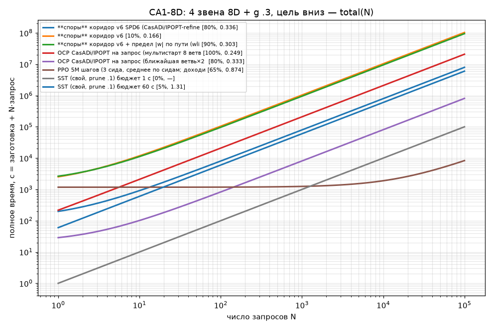

# CA1-8D: 4 звена 8D + g .3, цель вниз
20 стартов (поток rng(0), исключено эталоном 0); эталон T_ref — OCP CasADi/IPOPT (multiple shooting, 8 ветвей 2π × 4 затравки; для 3g — лучшее известное из r5 ref6d_T.json (|w|≤3 по пути); для 8D эталона нет: T_ref = ЛУЧШИЙ НАЙДЕННЫЙ T среди всех методов на этом старте (отношения к нему, не к оптимуму; старт без решения исключён)); единый проверяльщик `common.verify` (RK4 h .01) с допусками эталона: окно +1e-3, |w|≤3+1e-2. Цель — покой в q=0 (окно |q|<.3, |w|<.6). aida, CPU (запросы по 1 ядру; машина разделена с другими линиями, загрузка 20–25 из 32 ядер — времена запросов спор/OCP 8D завышены).
Пометка: T/T_ref < 1 возможно из-за допусков эталона и кусочно-постоянного u у эталона (N=50).

| метод | параметры | заготовка, с | запрос мед. / p90, с | total(N=20), с | дошли | T/T_ref мед / ср / p90 / max | вес данных | железо | примечание |
|---|---|---|---|---|---|---|---|---|---|
| **споры** коридор v6 SPD6 (CasADi/IPOPT-refine + скомпилированный поток, |w|≤3 по пути) | NB 60000, NF 15000, K 3, NEIGH 1; 10 процессов; load average aida при прогоне ~6 | 119 | 79.5 / 87.4 | 1.71e+03 | 80% | 0.336 / 0.297 / 0.37 / 0.378 | 354 МБ | CPU numpy+math | ФИНАЛ: IPOPT-refine (запас .004), gcc-поток; wlim |
| **споры** коридор v6 | NB 100000, NF 25000, K 3, эвристика back_heuristic; 1 ядро/запрос | 1.49e+03 | 1.03e+03 / 1.49e+03 | 2.22e+04 | 10% | 0.166 / 0.166 / 0.211 / 0.222 | 590 МБ | CPU numpy+math | SLSQP-доводка держит |w|≤3 только в узлах |
| **споры** коридор v6 + предел |w| по пути (wlim) | NB 100000, NF 25000, K 3, эвристика back_heuristic; 1 ядро/запрос | 1.69e+03 | 949 / 1.39e+03 | 2.07e+04 | 90% | 0.303 / 0.3 / 0.381 / 0.518 | 590 МБ | CPU numpy+math | жёсткий предел |w|≤3 в 16 точках сегмента |
| OCP CasADi/IPOPT на запрос (мультистарт 8 ветвей×4 затравки = эталон) | multiple shooting N50 M4 | 8.22 | 209 / 1.41e+03 | 4.18e+03 | 100% | 0.249 / 0.24 / 0.316 / 0.359 | — | CPU 1 проц. | T_ref = лучший найденный среди методов; OCP multi поставляет большинство T_ref ⇒ его отношение ≈1 по построению |
| OCP CasADi/IPOPT на запрос (ближайшая ветвь×2 затравки) | multiple shooting N50 M4 | 20.7 | 8.08 / 59.7 | 182 | 80% | 0.333 / 0.346 / 0.569 / 0.671 | — | CPU 1 проц. |  |
| PPO 5M шагов (3 сида, среднее по сидам; доходимость сидов 95%/100%/0%) | MlpPolicy 64×64, 16 env, CPU | 1.17e+03 | 0.0714 / — | 1.18e+03 | 65% | 0.874 / 0.911 / 1.39 / 1.72 | 39.5 КБ | CPU | до 95% дошёл за 386 с (сид 0); вес = 9863 параметров float32 (+VecNormalize) |
| SST (свой, prune .1) бюджет 0.3 с | sel .2 / prune .1; одиночный запрос | 0 | 0.3 / — | 6 | 0% | — / — / — / — | 196 КБ | CPU numpy | запрос = бюджет (anytime); дерево строится в запросе |
| SST (свой, prune .1) бюджет 1 с | sel .2 / prune .1; одиночный запрос | 0 | 1 / — | 20 | 0% | — / — / — / — | 550 КБ | CPU numpy | запрос = бюджет (anytime); дерево строится в запросе |
| SST (свой, prune .1) бюджет 3 с | sel .2 / prune .1; одиночный запрос | 0 | 3 / — | 60 | 0% | — / — / — / — | 1.22 МБ | CPU numpy | запрос = бюджет (anytime); дерево строится в запросе |
| SST (свой, prune .1) бюджет 10 с | sel .2 / prune .1; одиночный запрос | 0 | 10 / — | 200 | 0% | — / — / — / — | 2.6 МБ | CPU numpy | запрос = бюджет (anytime); дерево строится в запросе |
| SST (свой, prune .1) бюджет 60 с | sel .2 / prune .1; одиночный запрос | 0 | 60 / — | 1.2e+03 | 5% | 1.31 / 1.31 / 1.31 / 1.31 | 5.8 МБ | CPU numpy | запрос = бюджет (anytime); дерево строится в запросе |

### Безубыточность N* (total = заготовка + N·запрос), относительно спор (v6)
- **споры** коридор v6: споры дешевле при любом N (N* = 0) — качество ХУЖЕ спор, N* несопоставим: дошли 10% (споры 80%), T/T_ref мед 0.166 (споры 0.336)
- **споры** коридор v6 + предел |w| по пути (wlim): споры дешевле при любом N (N* = 0) — качество не хуже спор: дошли 90% (споры 80%), T/T_ref мед 0.303 (споры 0.336)
- OCP CasADi/IPOPT на запрос (мультистарт 8 ветвей×4 затравки = эталон): споры дешевле метода при N > 1 — качество не хуже спор: дошли 100% (споры 80%), T/T_ref мед 0.249 (споры 0.336)
- OCP CasADi/IPOPT на запрос (ближайшая ветвь×2 затравки): метод дешевле спор при любом N — качество не хуже спор: дошли 80% (споры 80%), T/T_ref мед 0.333 (споры 0.336)
- PPO 5M шагов (3 сида, среднее по сидам; доходимость сидов 95%/100%/0%): метод дешевле спор при N > 13 — качество ХУЖЕ спор, N* несопоставим: дошли 65% (споры 80%), T/T_ref мед 0.874 (споры 0.336)
- SST (свой, prune .1) бюджет 0.3 с: метод дешевле спор при любом N — качество ХУЖЕ спор, N* несопоставим: дошли 0% (споры 80%), T/T_ref мед — (споры 0.336)
- SST (свой, prune .1) бюджет 1 с: метод дешевле спор при любом N — качество ХУЖЕ спор, N* несопоставим: дошли 0% (споры 80%), T/T_ref мед — (споры 0.336)
- SST (свой, prune .1) бюджет 3 с: метод дешевле спор при любом N — качество ХУЖЕ спор, N* несопоставим: дошли 0% (споры 80%), T/T_ref мед — (споры 0.336)
- SST (свой, prune .1) бюджет 10 с: метод дешевле спор при любом N — качество ХУЖЕ спор, N* несопоставим: дошли 0% (споры 80%), T/T_ref мед — (споры 0.336)
- SST (свой, prune .1) бюджет 60 с: метод дешевле спор при любом N — качество ХУЖЕ спор, N* несопоставим: дошли 5% (споры 80%), T/T_ref мед 1.31 (споры 0.336)

